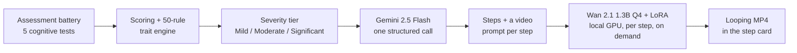

# FocusLoop

**Adaptive task breakdown and on-demand AI video guidance for people with ADHD.**

FocusLoop measures a user's executive function with five short interactive cognitive tests, turns the scores into a severity tier, and uses that tier to (1) break any everyday task into the right number of concrete steps with Gemini 2.5 Flash and (2) generate a short looping how-to clip for each step using a **locally hosted, 4-bit quantized Wan 2.1 text-to-video model with a custom LoRA adapter**, all on a 6 GB laptop GPU.

> Built during a summer research internship at PES University (2026). The project is no longer under active development. See [Results and status](#results-and-status) for an honest account of where it landed.


---

## How it works



1. **Assess.** A browser-based battery modeled on standard neuropsychological paradigms: a continuous performance test (sustained attention), an operation-span task (working memory), task-initiation scenarios, a Tower-of-London-style planning task, and a granularity / cognitive-load task.
2. **Classify.** Scores are normalized to 0-100. A deterministic, human-readable rule engine maps them to 50 interface traits, one of five executive-dysfunction styles, and a severity tier. This is a rule set rather than a learned model so every behavior can be traced back to a specific rule.
3. **Decompose.** A single schema-constrained Gemini call returns the step list *and* an optimized text-to-video prompt for every step, with wording adjusted to the severity tier.
4. **Render.** Each step's clip is generated only when the user opens it, queued one at a time to stay inside 6 GB of VRAM.

The full design, including the scoring formulas, is in [`docs/project_overview.md`](docs/project_overview.md).

## Tech stack

| Layer | What |
|---|---|
| Frontend | React 19 + Vite, lucide-react |
| Assessment | Vanilla JS app (`public/assessment/`), optional Firebase Firestore for collecting results |
| Backend | FastAPI (`backend/main.py`) |
| LLM | Gemini 2.5 Flash via REST with `responseSchema` structured output |
| Video model | Wan 2.1 T2V-1.3B: GGUF Q4_K_M transformer, BF16 VAE, 4-bit NF4 UMT5-XXL text encoder (bitsandbytes), diffusers |
| Fine-tuning | LoRA rank 64 on 455 captioned daily-living clips (see [`backend/weights/README.md`](backend/weights/README.md)) |
| Deployment | Docker Compose: nginx + frontend + backend |

## Sample output

Clips are 512x288, 17 frames at 16 fps (about 1 second, looped in the UI). A few generated examples are in [`docs/sample-clips/`](docs/sample-clips/).


https://github.com/user-attachments/assets/a6adaf00-4269-4b4a-bb23-5e58c9efa804


## Benchmarks (RTX 4050 Laptop, 6 GB)

| Stage | Latency (mean ± SD) | Peak allocated VRAM |
|---|---|---|
| Gemini task breakdown | 1.50 ± 0.10 s | (cloud) |
| Model + LoRA load (one-time) | 60.1 ± 2.2 s | 5.68 GB |
| Diffusion sampling, 20 steps | 57.2 ± 1.1 s | 1.52 GB |
| VAE decode | 4.83 ± 0.02 s | 2.04 GB |
| **End to end, first clip** | **124.1 ± 3.3 s** | 5.68 GB |

Full methodology and model footprint: [`docs/benchmark_results.md`](docs/benchmark_results.md). Reproduce with `backend/scripts/run_benchmarks.py`.

## Results and status

We stopped working on FocusLoop after the internship. Being upfront about why:

- **Video quality was not good enough to be useful as instruction.** At the resolution and frame count that fit in 6 GB (512x288, about 1 s), clips were often too short, too coarse, or not faithful enough to the prompt to really show *how* to do a step, especially for anything with fine hand movements.
- **The LoRA was only evaluated qualitatively.** It looked closer to the target domain than the base model in side-by-side comparisons, but 455 clips is a small dataset and we never measured the improvement quantitatively.
- **Generation is slow.** About 1 minute of sampling per 1-second clip on a laptop GPU, which is too slow for a "help me start this task now" use case.
- **The assessment is unvalidated.** A 17-person pilot (not screened for ADHD) behaved sensibly; task initiation was the lowest and most variable dimension (M = 32.8, SD = 23.3). But the thresholds are engineering defaults, not values validated against clinical outcomes.

What did work: the end-to-end pipeline on consumer hardware, the VRAM engineering that made a ~5B-parameter pipeline fit in 6 GB, schema-constrained single-call task decomposition, and a transparent rule-based personalization layer.

## Running it locally

**Requirements:** Node 20+, Python 3.10/3.11, an NVIDIA GPU with at least 6 GB VRAM and CUDA, and a [Gemini API key](https://aistudio.google.com/apikey). The task breakdown works without a GPU; video generation does not.

### 1. Get the model files (about 20 GB in total)

Put these in a `downloads/` folder at the repo root (or point `GGUF_PATH` / `VAE_PATH` at them):

- `Wan2.1-T2V-1.3B-Q4_K_M.gguf`: a GGUF quantization of Wan 2.1 T2V-1.3B (community GGUF repos on Hugging Face)
- `wan_2.1_vae.safetensors`: the Wan 2.1 VAE

The text encoder and configs are pulled from `Wan-AI/Wan2.1-T2V-1.3B-Diffusers` automatically on first run (or ahead of time with `backend/scripts/download_model.py`). Optionally add the LoRA, as described in [`backend/weights/README.md`](backend/weights/README.md).

### 2. Backend

```bash
cd backend
python -m venv .venv && .venv\Scripts\activate      # Windows  (source .venv/bin/activate on Linux/macOS)
pip install torch==2.6.0 --index-url https://download.pytorch.org/whl/cu124
pip install -r requirements.txt
copy .env.example .env                               # then add your GEMINI_API_KEY
python main.py                                       # serves on http://localhost:8000
```

### 3. Frontend

```bash
npm install
npm run dev                                          # http://localhost:5173
```

You can also paste the Gemini key into the app's Settings dialog instead of `backend/.env`.

### Docker

```bash
cp .env.example .env        # add GEMINI_API_KEY
docker compose up --build   # http://localhost:3000
```

GPU passthrough to the backend container needs the NVIDIA Container Toolkit.

## Repository layout

```
├── src/                     React app (task input, step timeline, video cards, settings)
├── public/assessment/       Executive-function assessment battery (standalone JS app)
├── backend/
│   ├── main.py              FastAPI: /api/breakdown (Gemini), /api/generate-video (Wan 2.1)
│   ├── scripts/             Benchmarking, LoRA inspection, model download
│   ├── experiments/         Loading/quantization experiments (8-bit, 4-bit, meta-device, pre-embedding)
│   └── weights/             LoRA goes here (not in git)
├── docs/                    Architecture write-up, benchmarks, sample clips
└── docker-compose.yml       nginx + frontend + backend
```

## Team

- M Naga Sai Abhiram
- Nishkal M R
- Mohammed Sinan M T

Mentor: Shylaja S S, Department of CSE, PES University

## Disclaimer

FocusLoop is a research prototype. It is not a diagnostic tool and is not a substitute for clinical assessment or treatment of ADHD
