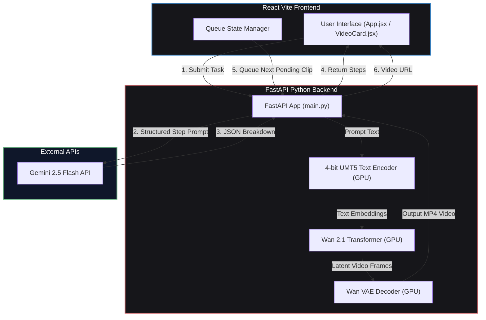
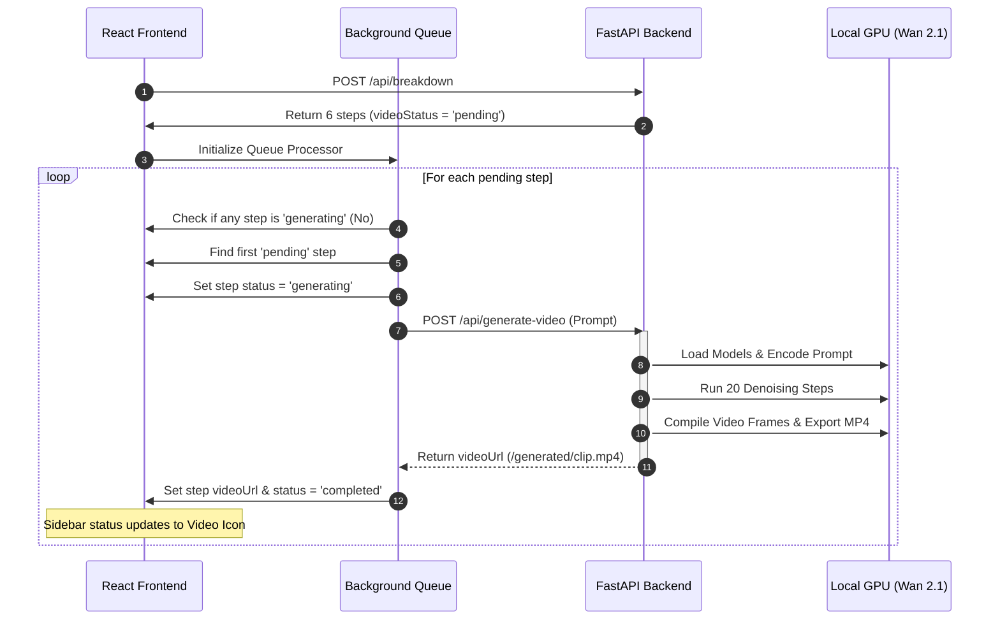
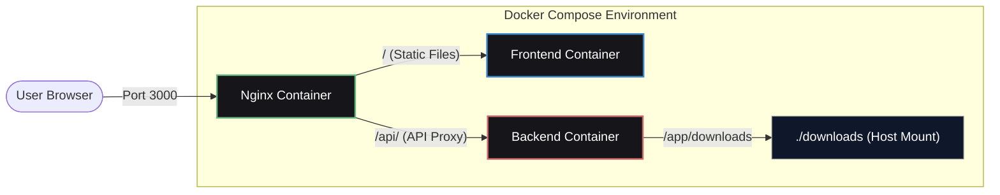

# FocusLoop: ADHD Step-by-Step Task Assistant
## Project Overview & Technical Architecture

FocusLoop is an occupational therapy-inspired ADHD assistant designed to help individuals overcome executive dysfunction. It takes complex, overwhelming tasks, breaks them down into clear, mature, micro-checklists using **Google Gemini 2.5 Flash**, and automatically generates looping, photorealistic video guides using the local **Wan 2.1 Video Model** in the background.

---

## 1. System Architecture Diagram

The system is split into a modern React frontend and a FastAPI backend. The backend manages the local PyTorch pipelines for GPU video generation and interacts with external API endpoints.

---

## 2. Step-by-Step Workflows

### Phase A: Task Breakdown (Gemini)
1. **User enters a task** (e.g. *"make pancakes"*) and selects an ADHD severity profile (Mild, Moderate, Significant).
2. **Gemini 2.5 Flash** is called via the backend using a structured schema:
   - **Mild**: 4 simple steps, higher-level details.
   - **Moderate**: 6 steps, balanced checklist.
   - **Significant**: 8 steps, ultra-granular micro-instructions.
3. The API returns a JSON array containing titles, descriptions, specific sub-task checklists, and optimized video generation prompts.

### Phase B: Automatic Background Video Queue
To prevent GPU memory overloading, generations are queued and run sequentially.

---

## 3. Optimizations & Technical Tweaks Implemented

During development, several key upgrades were implemented to ensure stability, portability, and maximum rendering speed:

### 1. GPU VRAM & Performance Tuning
* **Double-Hook Fix**: Previously, loading the quantized 4-bit UMT5 text encoder (via bitsandbytes) alongside `enable_model_cpu_offload()` caused a device mismatch crash. We disabled CPU offloading and loaded all weights directly to the GPU (`to("cuda")`).
* **Dedicated VRAM Management**: To prevent Windows from paging VRAM into system memory (which slowed down steps to 5 minutes each), we optimized:
  - **Resolution**: Lowered from 832x480 to `512x288`.
  - **Frame Count**: Lowered from 33 to `17` frames (~1 second looping guide).
  - This reduced VRAM usage by ~1.5 GB and kept the entire pipeline under the RTX 4050's 6 GB VRAM ceiling, so Windows stopped paging VRAM into system RAM. Measured latencies after these changes are in [`benchmark_results.md`](benchmark_results.md): about **57 s for the 20-step sampling loop** and about **2 minutes end to end** including model loading.

### 2. UI Status Tracking
* Decoupled loading states so that switching steps in the outline doesn't interrupt active background renderings.
* Added colors, queue badges (`Generating clip 2 of 6`), and dynamic messages in the card (`Waiting in queue - 2 steps ahead`).

### 3. Portable Dockerization
* Configured the docker containers (`Dockerfile.backend`, `Dockerfile.frontend`, and `nginx.conf`) to build portably by converting the hardcoded absolute Windows path mapping (`D:/Downloads`) to a relative mapping (`./downloads`).

---

## 4. Container Architecture Layout

The Docker setup uses a reverse proxy to route frontend assets and API requests seamlessly.

---

## 5. Mathematical Formulations for Cognitive Scoring & Classification

To make FocusLoop's scoring engine academically rigorous for presentations and research papers, the clinical rules are represented as formal mathematical formulations.

### A. Raw Score Normalization
Let \(X_{\text{raw}}\) represent the raw metric from a cognitive test (e.g., reaction time variance, recall accuracy). The normalized score \(S_{\text{norm}} \in [0, 100]\) is defined as:

\[
S_{\text{norm}} = \text{round}\left( \max\left(0, \min\left(100, \frac{X_{\text{raw}} - X_{\text{min}}}{X_{\text{max}} - X_{\text{min}}} \times 100\right)\right) \right)
\]

where \(X_{\text{min}}\) and \(X_{\text{max}}\) represent floor and ceiling calibration limits for each assessment task.

### B. Cognitive Deficit Indicators
We define a cognitive domain score vector \(\vec{S}\) representing the 5 core executive functions:

\[
\vec{S} = [S_{\text{att}}, S_{\text{wm}}, S_{\text{init}}, S_{\text{plan}}, S_{\text{cog}}]
\]

where:
* \(S_{\text{att}}\): Sustained Attention Score
* \(S_{\text{wm}}\): Working Memory Score
* \(S_{\text{init}}\): Task Initiation Score
* \(S_{\text{plan}}\): Planning & Sequencing Score
* \(S_{\text{cog}}\): Cognitive Load Tolerance Score

An indicator function \(D_i \in \{0, 1\}\) identifies a clinical executive functioning deficit in domain \(i\) (using the clinical threshold score of \(50\)):

\[
D_i = \mathbb{I}(S_i < 50) = \begin{cases} 
1 & \text{if } S_i < 50 \\ 
0 & \text{if } S_i \ge 50 
\end{cases}
\]

The cumulative deficit count \(N_{\text{dys}}\) is the sum of these indicator variables:

\[
N_{\text{dys}} = \sum_{i \in \{\text{att}, \text{wm}, \text{init}, \text{plan}, \text{cog}\}} D_i
\]

### C. Executive Style Classification
The user's cognitive executive profile classification \(C\) is determined via a hierarchical decision logic tree:

\[
C = \begin{cases} 
\text{Combined Executive Dysfunction Style} & \text{if } N_{\text{dys}} \ge 4 \\
\text{Inattentive / Focus-Vulnerable Style} & \text{if } D_{\text{att}} = 1 \land D_{\text{wm}} = 1 \\
\text{Initiation \& Sequencing Paralysis Style} & \text{if } D_{\text{init}} = 1 \land D_{\text{plan}} = 1 \\
\text{Executive Overload-Sensitive Style} & \text{if } D_{\text{cog}} = 1 \\
\text{Balanced Executive Style} & \text{otherwise}
\end{cases}
\]

### D. Severity Mapping to Task Granularity
The cumulative deficit count \(N_{\text{dys}}\) directly configures the GPT/Gemini-driven task generator to adjust step decomposition:

\[
\text{ADHD Severity} = \begin{cases} 
\text{Significant (8 micro-steps)} & \text{if } N_{\text{dys}} \ge 3 \\
\text{Moderate (6 steps)} & \text{if } 1 \le N_{\text{dys}} < 3 \\
\text{Mild / Balanced (4 macro-steps)} & \text{if } N_{\text{dys}} = 0
\end{cases}
\]

---

## 6. Neuropsychological Paradigms & Scoring Algorithms

FocusLoop's diagnostics are based on standard clinical cognitive paradigms used in neuropsychological assessments for ADHD. Below are the specific algorithms and scientific rationales behind each score.

### A. Sustained Attention (Continuous Performance Test - CPT)
* **Clinical Paradigm**: Modeled directly on the **Conners CPT** and the **Test of Variables of Attention (TOVA)**.
* **Mechanics**: The user monitors a stream of 36 letters appearing every 800ms (400ms gap). The target letter "A" appears with a probability of \(p = 0.30\). Responses to distractor letters are errors.
* **Scoring Metrics**:
  1. **Omissions (Misses)**: Indicates attention lapses / hypo-arousal.
  2. **Commissions (False Alarms)**: Indicates response inhibition deficits / impulsivity.
  3. **Reaction Time Variability (RTV)**: The standard deviation of hit response times (\(\sigma_{\text{RT}}\)). A high RTV is the most consistent diagnostic biomarker of ADHD.
* **Mathematical Score Algorithm**:
  Let \(N_T\) be target stimuli, \(N_D\) distractor stimuli, \(H\) hits, \(FA\) false alarms, and \(\sigma_{\text{RT}}\) the reaction time variability (in milliseconds). The raw attention score \(S_{\text{att, raw}}\) is computed as:

  \[
  S_{\text{att, raw}} = 100 \times \left( 0.4 \cdot \frac{H}{N_T} + 0.3 \cdot \left(1 - \frac{FA}{N_D}\right) + 0.3 \cdot \left(1 - \frac{\min(\sigma_{\text{RT}}, 300)}{300}\right) \right)
  \]

---

### B. Working Memory (Dual-Task Operation Span - OSPAN)
* **Clinical Paradigm**: Based on the **Operation Span Task (OSPAN)**, the gold standard for measuring working memory capacity under high executive load.
* **Mechanics**: Users must memorize lists of words (5 to 7 words). Between each word, they must solve a rapid arithmetic verification task (e.g., \(2 + 3 \stackrel{?}{=} 6\)) within 3 seconds to prevent sub-vocal rehearsal.
* **Scoring Metrics**:
  1. **Recall Accuracy (\(A_{\text{rec}}\))**: Percentage of words correctly identified from a distractor grid.
  2. **Recall Speed (\(t_{\text{rec}}\))**: Retrieval latency.
  3. **Distractor Accuracy (\(A_{\text{dist}}\))**: Math verification accuracy (must be \(\ge 80\%\) to ensure validity).
* **Mathematical Score Algorithm**:
  Let \(K_{\text{span}}\) be the word list size in a given round, and \(K_{\text{max}}\) the peak difficulty span (7). The working memory score \(S_{\text{wm}}\) is formulated as:

  \[
  S_{\text{wm}} = \text{round}\left( 100 \times \frac{K_{\text{span}}}{K_{\text{max}}} \times A_{\text{rec}} \times A_{\text{dist}} \right)
  \]

---

### C. Task Initiation (Implementation Intentions & Friction)
* **Clinical Paradigm**: Grounded in Peter Gollwitzer's **Implementation Intentions** theory and research on executive procrastination.
* **Mechanics**: Users face 5 daily scenario prompts and must select their immediate response option. The options represent four initiation categories:
  * **Actionable/Concrete**: (\(W_{\text{action}} = 1.0\)) - Instant physical step.
  * **Vague/Mental**: (\(W_{\text{vague}} = 0.4\)) - Conceptual planning loop.
  * **Procrastination/Delay**: (\(W_{\text{delay}} = 0.1\)) - Avoidance.
  * **Paralyzed/Stuck**: (\(W_{\text{stuck}} = 0.0\)) - Defeat.
* **Mathematical Score Algorithm**:
  Let \(W_k\) be the weight of the chosen option for scenario \(k\), and \(t_k\) the latency (in seconds) taken to select the option. The initiation score \(S_{\text{init}}\) penalizes choice delay to capture hesitation:

  \[
  S_{\text{init}} = \frac{1}{5} \sum_{k=1}^{5} \left( 100 \cdot W_k \times e^{-0.05 \cdot \max(0, t_k - 3)} \right)
  \]

---

### D. Planning & Sequencing (Tower of London Equivalent)
* **Clinical Paradigm**: Modeled on the **Tower of London (TOL)** task which measures planning, spatial problem-solving, and sequencing logic.
* **Mechanics**: Reordering a shuffled list of 5 tasks with hidden dependencies (e.g., Morning Routine ➔ Start Laundry ➔ Attend Class ➔ Attend Meeting ➔ Do Homework).
* **Scoring Metrics**:
  1. **Optimal Positions (\(P_{\text{match}}\))**: Count of items in correct positions.
  2. **Revision Count (\(R\))**: Number of sequence re-adjustments.
  3. **Drag Count (\(D\))**: Mechanical attempts.
* **Mathematical Score Algorithm**:
  Given 5 tasks, where \(P_{\text{match}} \in [0, 5]\), \(R\) is the number of reorder actions, and \(T\) is time taken (seconds):

  \[
  S_{\text{plan}} = \max\left(0, \left(20 \cdot P_{\text{match}}\right) - 2 \cdot \max(0, R - 2) - 0.1 \cdot T\right)
  \]

---

### E. Cognitive Load Tolerance & Granularity Preference
* **Clinical Paradigm**: Derived from John Sweller's **Cognitive Load Theory (CLT)**, measuring performance degradation under high instruction complexity.
* **Mechanics**: Users read instruction blocks of increasing complexity (Simple, Moderate, Complex) and answer comprehension questions under time constraints.
* **Mathematical Score Algorithm**:
  Let \(A_{\text{simple}}, A_{\text{mod}}, A_{\text{comp}}\) represent the correctness percentages at each level. The cognitive load tolerance score \(S_{\text{cog}}\) measures decay:

  \[
  S_{\text{cog}} = \text{round}\left( 100 \times \frac{A_{\text{simple}} + 2 \cdot A_{\text{mod}} + 3 \cdot A_{\text{comp}}}{6} \times \left(1 - \text{Decay}\right) \right)
  \]

  where \(\text{Decay} = \max\left(0, A_{\text{simple}} - A_{\text{comp}}\right)\). A high decay coefficient indicates sensitivity to complex multi-conditional layouts, requiring maximum task granularity decomposition.

